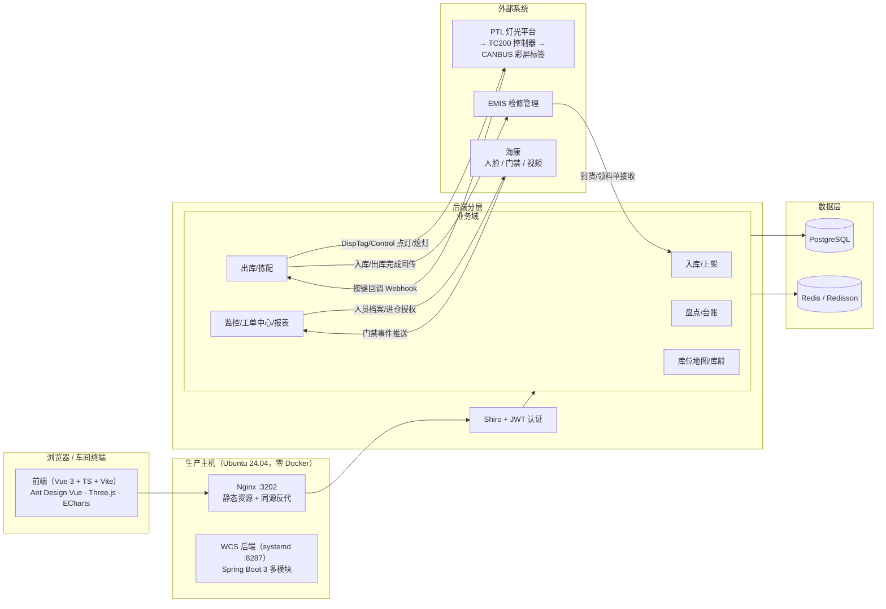

# 雪花智能备件仓 WCS（备件仓储管理与灯光拣选系统）

面向设备备件仓的**仓储管理系统（WCS/WMS）**：覆盖「到货登记 → 上架 → 领料出库 → 盘点 → 库存台账」全链路，
集成 **PTL 电子标签灯光拣选**（TC200 控制器 / CANBUS 彩屏标签）、**海康人脸门禁**与 **EMIS 检修管理系统**，
支持库位级 FIFO 先进先出、库龄分析与处置审批、2D/3D 库位地图与工作台驾驶舱。

> 本仓库 `main` 分支为**后端**（Spring Boot 3 多模块），`frontend` 分支为**前端**（Vue 3 + TS）。

## 功能总览

| 模块 | 说明 |
| --- | --- |
| 入库管理 | 到货登记（送货单/全景照/检验报告三要素硬校验）→ 自动分配库位 + 自动生成上架任务 → 上架确认 |
| 出库管理 | EMIS 领料单接收 → **库位级 FIFO 自动分配**（按最早上架时间升序拆行，总量不足整单拒绝）→ 链式灯光拣配 → 行级确认扣减 |
| 盘点管理 | 库位级盘点：start → 冻结 → 生成账面快照 → 逐行实盘 → **差额原子入账** + 解冻；冻结期拦截入库 |
| 库存台账 | bin 表数量账：上架原子累加、出库 `UPDATE WHERE qty >= n` 原子扣减、盘点差额入账，三入口联动零对账差异 |
| 库位地图 | 平面地图（分区网格六状态 + 搜索高亮）+ **Three.js 3D 货架查看器**（库位状态着色、目标位脉动、点击选位） |
| 库龄分析 | 口径=库位最早确认上架距今；五档分布 + 分类分析 + 处置审批流（发起→审批→通过/驳回） |
| 监控管理 | 人员注册（海康人脸档案）、进出识别记录（门禁事件时间线）、视频搜索 |
| 工单中心 / 备件使用报表 | 三域单据聚合查询；出库用途跟踪（lazy 回填 + 确认弹窗 + 超 1 周未使用提醒 + Excel 导出） |
| 工作台驾驶舱 | 深色大屏 1:1，一次聚合接口 + 60s 轮询 |

## 技术栈

- **后端**：Java 17 · Spring Boot 3 · MyBatis-Plus · PostgreSQL · Redis · Redisson · JeecgBoot 脚手架
- **前端**：Vue 3 · TypeScript · Vite · Ant Design Vue · Three.js · ECharts
- **测试**：接口级自动化测试 26 例（HTTP 断言 + PostgreSQL 直查双校验，测试数据自清理）

## 架构图

## 关键设计

### 库存台账原子化（三入口联动）

- 上架确认：`SET qty = qty + n` 原子累加（防丢失更新），混装库位拦截
- 出库确认：`UPDATE ... WHERE qty >= n` 原子扣减，0 行 = 库存不足整单回滚
- 盘点差异：按差额入账，不覆盖盘点期间正常出入库流水

### 并发防护三件套

单号查重（原生 SQL 计数含软删行）+ `pg_advisory_xact_lock` 事务级咨询锁串行化 + 单号唯一索引兜底——并发"幽灵单号"根治；库位分配 `FOR UPDATE SKIP LOCKED`。

### PTL 电子标签全链路

WCS → 灯光平台（HTTP DispTag/Control）→ TC200 控制器（TCP/CAN 桥）→ CANBUS 彩屏标签；按键回调 Webhook 工程化：匿名端点白名单、`WHERE status=0` 条件更新防双击、应答语义如实（网关重试安全）、操作审计落库；出库**链式拣配主动点亮下一站**，一次按键驱动整条拣配序列。

### 部署形态

Ubuntu 24.04 零 Docker：后端 jar + systemd 服务、Nginx 静态托管 + 同源反代免跨域，与灯光指引拣选系统同机共存。

## 仓库分支

| 分支 | 内容 |
| --- | --- |
| `main` | 后端（本分支）：Spring Boot 3 多模块 Maven 工程 |
| `frontend` | 前端：Vue 3 + Vite 工程 |
